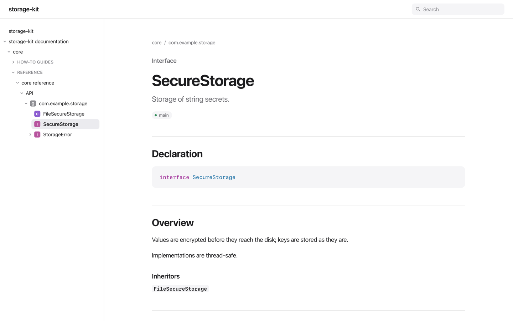

# docs-site

A Gradle plugin that turns the documentation of a repository into a static site: the Markdown pages of
`README.md` and `documentation/` (or `docs/`), PlantUML diagrams drawn from their sources, interactive HTML pages
and the Dokka API reference of the modules, under one navigation with one search. The site works offline, from the
file system or from a local server with live reload, and `docsCheck` finds broken links, anchors and stale
diagrams and lints the Markdown with rumdl.



## Features

- **Markdown as on GitLab and GitHub.** Relative links between `.md` files, heading anchors by the rules of GitHub
  (default) or GitLab (`anchorStyle.set("gitlab")`), GFM tables, task lists and autolinks. The site keeps the
  layout of the repository, so the links stay valid.
- **Diagrams from source.** Every `.puml` is drawn to SVG at build time, the ELK layout included; the committed SVG
  is never shown. `docsDiagrams` writes the same SVG next to the source for the Git hosting. Diagrams can be zoomed,
  panned and opened full screen.
- **API reference inside the documentation.** The Dokka pages of the modules that apply Dokka are shown in the
  site layout, under the library they belong to. Inline code such as `Greeter` or `Greeter.greet`
  in the Markdown pages links to the declaration.
- **Interactive pages.** Self-contained HTML pages of the documentation open inside the site, with their own
  scripts and styles untouched.
- **Code highlighting at build time** for Kotlin, Swift, Java, Groovy, shell, JSON, YAML, XML, C family, CMake,
  properties and TOML, PlantUML and diff.
- **Search** over the pages, the sections, the declarations and the interactive pages.
- **Checks**: links, anchors, PlantUML errors, line length (the limit of `.editorconfig`), forbidden characters and,
  optionally, committed SVG out of date with its source.
- **Markdown linter.** [rumdl](https://github.com/rvben/rumdl) checks the pages by the markdownlint rules of the
  repository's own `.markdownlint.json` or `.rumdl.toml`, and `docsFormat` fixes what it can, tables
  included.
- English or Russian interface; light and dark theme; works on a phone.

## Quick start

`settings.gradle.kts`: the plugin, the Dokka command line and PlantUML come from Maven Central and the Gradle Plugin
Portal. The Ivy repository over the npm registry gives the browser build of PlantUML, which only `plantUml.render`
`auto` and `browser` need; without it the site builds the same.

```kotlin
pluginManagement {
    repositories {
        gradlePluginPortal()
        mavenCentral()
    }
}

dependencyResolutionManagement {
    repositories {
        mavenCentral()
        ivy {
            url = uri("https://registry.npmjs.org")
            patternLayout { artifact("@plantuml/[module]/-/[module]-[revision].[ext]") }
            metadataSources { artifact() }
            content { includeGroup("plantuml-npm") }
        }
    }
}
```

`build.gradle.kts` of the root project:

```kotlin
plugins {
    id("io.github.wolfandrei.docs-site") version "0.1.0"
}
```

Then:

```shell
./gradlew docs           # builds the site and serves it on http://localhost:8000/
./gradlew docsBuild      # build/docs-site/index.html
./gradlew docsCheck      # links, anchors, diagrams, style, Markdown lint
./gradlew docsFormat     # fixes the Markdown pages in place
```

The API reference needs nothing more than `id("org.jetbrains.dokka") version "2.1.0"` in the modules to document.

## Documentation

- [How to set up, build, serve and check the site](docs/how-to/usage.md)
- [Configuration and tasks](docs/reference/configuration.md)
- [How the plugin works](docs/explanation/architecture.md)

The Markdown linter needs the rumdl binary. The plugin downloads it on the first run from the GitHub releases of
rumdl, checks its SHA-256 and caches it in the Gradle user home; a mirror, an offline build and a local binary are
described in [Lint the Markdown pages](docs/how-to/usage.md#lint-the-markdown-pages).

## License

Apache License 2.0, see [LICENSE](LICENSE). Third-party components and their licenses are listed in
[NOTICE](NOTICE). rumdl (MIT License) is not bundled with the plugin: it is downloaded at build time.
